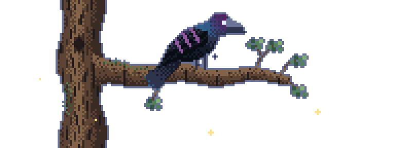

# git-raven

A pixel-art raven drawn from your GitHub activity, as a looping GIF for your profile README.

<p align="center"></p>

| Your activity | The raven |
|---|---|
| Top two languages | Colour of the feather sheen (iridescence blends between them) |
| Contributions in the last year | Growth, six stages from fledgling to full raven |
| Current streak | A bright sheen band on the wings for every 7 days (up to 4) |
| Yesterday's activity | How it flies: none glides, a quiet day flaps slowly, a busy day soars wide and fast |
| Stars on your repos | Shiny things twinkling around it, because ravens collect them |

Growth thresholds: 0, 150, 500, 1,500, 4,000 and 10,000 contributions.

## Use it on your profile

1. Make a repo named after your username (`<username>/<username>`) if you don't have one.
2. Copy `.github/workflows/example-profile.yml` into it as `.github/workflows/raven.yml`
   and keep `uses: Ylli-Berisha/git-raven@main` (or point it at your fork).
3. Add the GIF to your profile `README.md`:

```md

```

It redraws itself every night.

## Run it locally

```bash
pip install pillow
python -m git_raven --demo -o raven.gif         # sample data, no token needed
python -m git_raven <username> -o raven.gif     # needs GITHUB_TOKEN or `gh auth login`
```

Flags `--stage`, `--streak` and `--yesterday` override the fetched values.

## Develop

```bash
pip install pillow pytest && pytest
```

The renderer (`git_raven/render.py`) draws on a 128x128 grid, scaled 4x to 512x512,
with ordered dithering, a thin outline and a transparent background.

MIT licensed.
